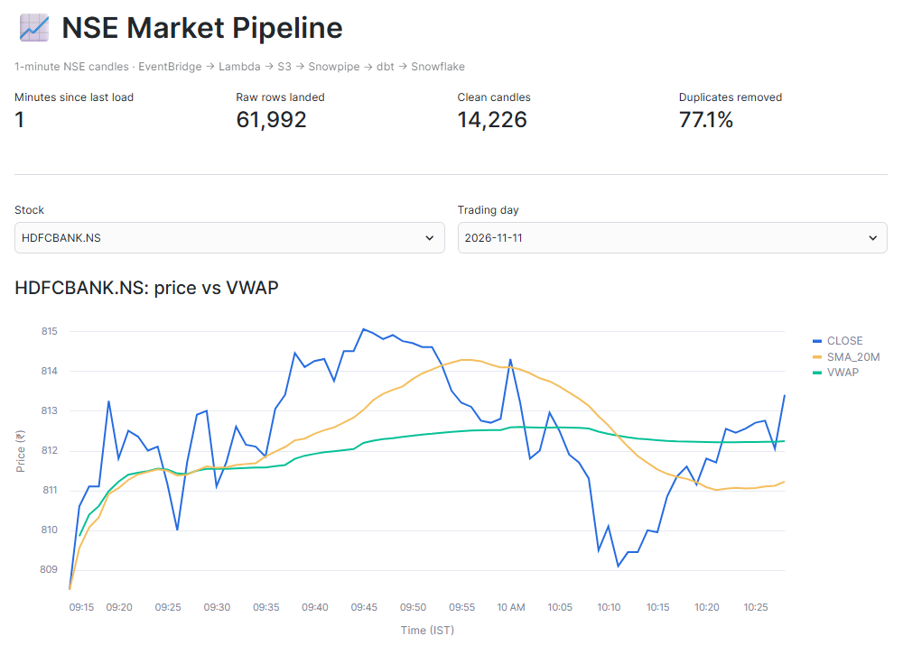
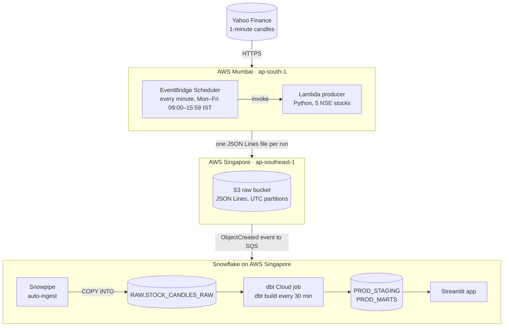
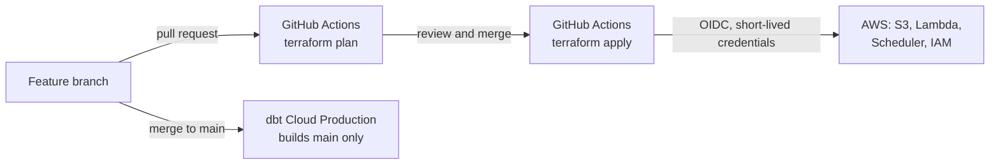
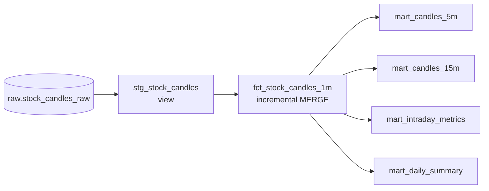
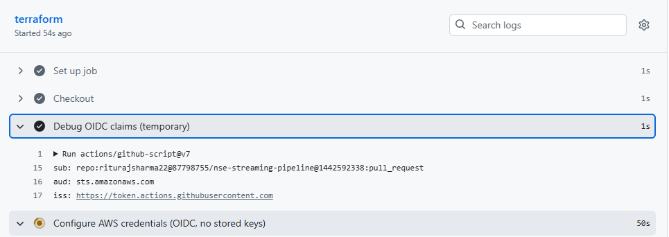
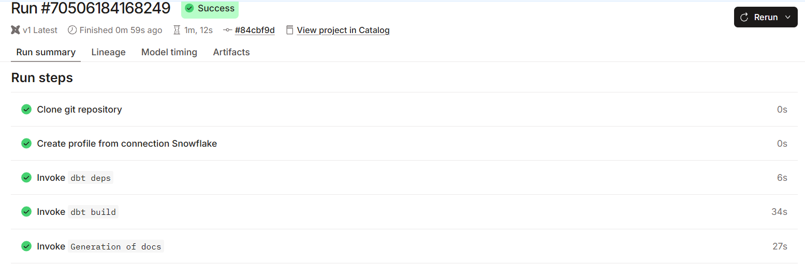
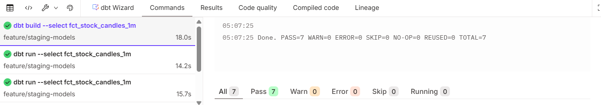
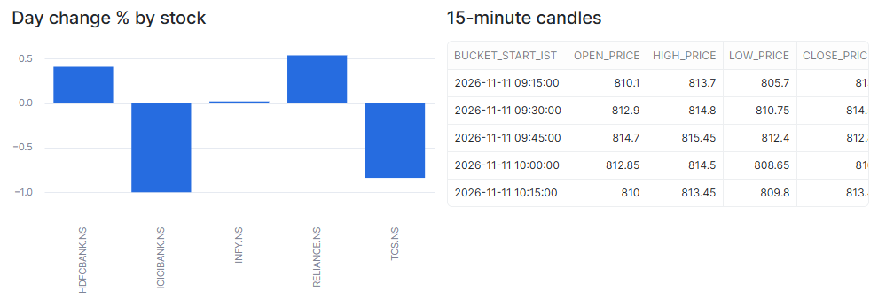
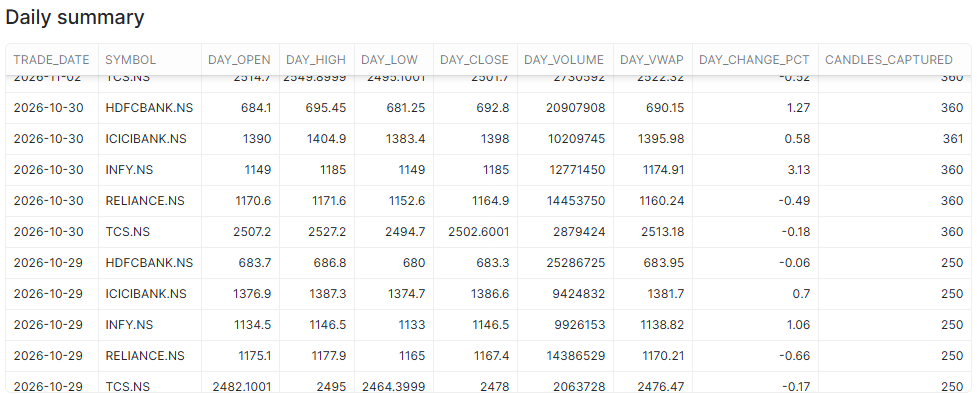
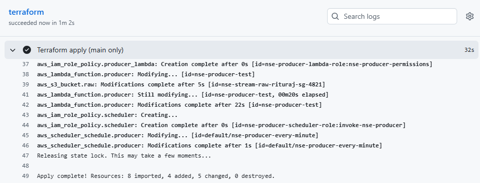

# NSE Near Real-Time Market Data Pipeline

[](https://github.com/riturajsharma22/nse-streaming-pipeline/actions/workflows/terraform.yml)

A serverless pipeline that captures 1-minute price candles for five NSE stocks every minute during market hours. Files land in Amazon S3, Snowpipe loads them into Snowflake as they arrive, and dbt turns them into tested, deduplicated intraday analytics. The AWS side is defined in Terraform and deployed by GitHub Actions, with no cloud keys stored anywhere.



## Highlights

- **Event-driven ingestion.** Each new file in S3 triggers Snowpipe, so candles reach Snowflake about 1–2 minutes after they close.
- **At-least-once delivery, one clean row per minute.** The producer re-sends recent candles on purpose, so a failed run loses nothing. dbt removes the duplicates (about 77% of raw rows) and an incremental `MERGE` keeps exactly one row per stock per minute.
- **Tested models.** Six data tests, including a custom generic test, plus a reusable macro for N-minute candles.
- **Separate dev and prod.** Development builds into personal schemas. Production runs only reviewed code from `main`, every 30 minutes, with email alerts on failure.
- **No stored secrets.** GitHub Actions gets short-lived AWS credentials through OIDC, and dbt logs in to Snowflake with a key pair through a service user.
- **Zero-downtime move to Terraform.** Resources first built in the AWS console were adopted with `import` blocks (8 imported, 4 added, 5 changed, 0 destroyed) while data kept flowing.
- **Runs entirely on free tiers:** the AWS Free plan, a Snowflake trial and the dbt Cloud Developer plan.

## Background

This is my own build of the architecture in ProjectPro's [Build a Streaming Pipeline with DBT, Snowflake and Kinesis](https://www.projectpro.io/project-use-case/dbt-streaming-project-with-snowflake-and-kinesis). I wrote it from scratch to run at no cost, which changed several parts of the design:

| Original design | This build | Why |
|---|---|---|
| Python producer on EC2 | Lambda function triggered by EventBridge Scheduler | Nothing to keep running or patch; fits the AWS Free plan |
| Kinesis Data Firehose into S3 | The Lambda batches and partitions the files itself | Firehose isn't available on the AWS Free plan |
| Snowflake external table over S3 | Snowpipe auto-ingest into a raw table | Event-driven loads, with a record of where every row came from |
| Terraform | Terraform run by GitHub Actions: plan on pull request, apply on merge | Every infrastructure change is reviewed, and no AWS keys are stored |
| (none) | Streamlit app inside Snowflake | Snowsight's legacy dashboards were retired in 2026 |

## Architecture



Infrastructure and model changes reach production the same way: through a pull request into `main`.



## How it works

1. **Schedule.** EventBridge Scheduler invokes the producer every minute, Monday to Friday, 09:00–15:59 IST. The NSE session runs 09:15–15:30, so this window covers it with a margin.
2. **Produce.** The Lambda function fetches 1-minute candles for RELIANCE, TCS, HDFCBANK, INFY and ICICIBANK. It skips the minute that is still forming, drops empty candles, re-sends the last five closed candles, and writes one JSON Lines file per run to `raw/stocks/year=YYYY/month=MM/day=DD/hour=HH/` (UTC).
3. **Load.** The bucket sends an `ObjectCreated` event to Snowpipe's SQS queue. Snowpipe copies the file into `RAW.STOCK_CANDLES_RAW`, keeping the JSON untouched in a `VARIANT` column next to the source file, line number and load time.
4. **Transform.** A dbt Cloud job runs `dbt build` on the production environment every 30 minutes, 09:30–16:00 IST: staging, an incremental fact table, four marts and all data tests.
5. **Serve.** A Streamlit app inside Snowflake reads only the production marts.

## Data model (dbt)



| Model | Materialization | Purpose |
|---|---|---|
| `stg_stock_candles` | view | Parses the JSON, casts types, converts UTC to IST, and keeps the latest version of each (symbol, minute) with `QUALIFY ROW_NUMBER()` |
| `fct_stock_candles_1m` | incremental, `MERGE` on `symbol` + `candle_ts_utc` | One row per stock per minute. Each run re-processes the last 30 minutes of loads, so a candle re-sent with a revised volume is updated in place |
| `mart_candles_5m`, `mart_candles_15m` | table | 5- and 15-minute candles from the `ohlc_rollup` macro |
| `mart_intraday_metrics` | table | Running VWAP, 20-minute moving average, 1-minute return and an above/below-VWAP flag |
| `mart_daily_summary` | table | Day open, high, low, close, volume, VWAP, % change and candles captured |

**Data tests**, run by every `dbt build`:

| Test | Kind | What it guarantees |
|---|---|---|
| `unique_combination(symbol, candle_ts_utc)` | Custom generic test | One row per stock per minute |
| `not_null` on `symbol`, `candle_ts_utc`, `close_price` | Built-in (3 tests) | Key fields are always filled |
| `accepted_values` on `symbol` | Built-in | Only the five tracked tickers appear |
| `assert_valid_ohlc` | Singular test, severity `warn` | Open and close lie between low and high, and volume isn't negative. A bad tick is flagged without stopping the pipeline |

**Environments:**

| | Development | Production |
|---|---|---|
| Runs in | dbt Studio (browser IDE) | Scheduled deploy job |
| Code | Feature branches | `main` only |
| Schemas | `DBT_RITURAJ_STAGING`, `DBT_RITURAJ_MARTS` | `PROD_STAGING`, `PROD_MARTS` |
| Snowflake login | `DBT_USER` with a key pair, role `TRANSFORM` | Same |

## Design decisions

- **Serverless producer instead of EC2 + Firehose.** The Lambda function does Firehose's job itself: one JSON Lines file per run, under a time-partitioned prefix. No server runs between sessions, and usage stays within AWS's always-free Lambda and Scheduler limits.
- **At-least-once delivery, idempotent processing.** Re-sending the last five candles means a failed run, or a minute the source hasn't filled yet, gets picked up by the next run. The cost is duplicates, which are expected and removed by key in staging and by `MERGE` in the fact table.
- **Schema-on-read raw layer.** The raw table stores each record exactly as it arrived. If the producer adds a field, loading doesn't break; parsing lives in dbt, where it is versioned and tested.
- **UTC in storage, IST in reporting.** S3 partitions and raw timestamps are UTC. dbt converts to `Asia/Kolkata` for trading-day logic.
- **Freshness vs. cost.** Raw data lands every minute, but production models refresh every 30 minutes. The dbt Cloud Developer plan allows 3,000 successful model builds a month: 6 models × 14 runs a day × about 22 trading days is roughly 1,850. Running every minute would use the month's quota in under two days.
- **Least privilege.**
    - The Lambda role can only `s3:PutObject` under `raw/`, plus write its own logs.
    - Snowflake's AWS role can only read `raw/`, and trusts only Snowflake's identity presenting this account's external ID.
    - dbt uses a `TYPE = SERVICE` Snowflake user with the `TRANSFORM` role and key-pair login only. Everything dbt builds is owned by `TRANSFORM`.
    - Only this repository can assume the GitHub Actions role. Its S3, Lambda and Scheduler permissions cover this project's resources only; its IAM permissions are broader so Terraform can manage the pipeline's roles (see future improvements).
- **Infrastructure as code, adopted in place.** I built the pipeline in the AWS console first to learn each piece, then brought it under Terraform with `import` blocks instead of recreating it. Terraform state lives in a versioned S3 bucket with native locking.

## Challenges and how I solved them

**The newest candle often came back empty.** My first test returned `null` prices for the latest minute because the source hadn't filled it yet. The producer now skips the minute that is still forming, drops empty candles and re-sends a five-candle window, so a late minute simply arrives on the next run.

**Snowpipe auto-ingest is region-bound.** S3 can only send event notifications to an SQS queue in the same region as the bucket, and the Snowflake trial didn't offer AWS Mumbai. I moved the raw bucket to Singapore, next to the Snowflake account. The Lambda stays in Mumbai and writes across regions.

**Password logins are being retired.** Snowflake is phasing out single-factor password sign-ins, and dbt no longer accepts password authentication for Snowflake. dbt connects with an encrypted RSA key pair through a service user that cannot log in with a password at all. The private key never touches the repository.

**GitHub Actions couldn't assume the AWS role.** The trust policy matched `repo:riturajsharma22/nse-streaming-pipeline:*`, yet AWS returned `Not authorized to perform sts:AssumeRoleWithWebIdentity`. A temporary workflow step printed the token's claims (never the token itself), and the subject turned out to use immutable IDs: `repo:riturajsharma22@87798755/nse-streaming-pipeline@1442592338:pull_request`. Matching that format fixed it, and it is stricter too: a repository deleted and recreated under the same name gets a new ID.



**Moving live infrastructure into Terraform.** The plan on the pull request showed `8 to import, 4 to add, 5 to change, 0 to destroy`, so nothing would be replaced. During the apply, the Lambda function and the schedule switched to new least-privilege roles, and a new file still landed in S3 every minute.

**Dashboards were retired.** Snowflake removed legacy Snowsight dashboards in 2026, so reporting moved to a Streamlit app inside Snowflake. It reads only production marts, passes filter values as bind parameters, and caches results for five minutes so browsing doesn't keep the warehouse running.

## Results

Snapshot from 11 November 2026, two weeks after the first run:

| Metric | Value |
|---|---|
| Stocks tracked | 5 |
| Producer schedule | Every minute, Mon–Fri 09:00–15:59 IST |
| Candle close to Snowflake raw table | About 1–2 minutes |
| Candles captured per stock in a full session | About 360 of 375 minutes |
| Raw rows that were duplicates | About 77% (61,992 raw rows → 14,226 clean candles) |
| Production refresh | Every 30 minutes, 09:30–16:00 IST |
| Data tests | 6, all passing |
| Snowflake credits used | About $3 of the $400 trial |

## Repository layout

```
.
├── .github/workflows/terraform.yml   # plan on pull request, apply on merge (OIDC)
├── lambda/nse_producer/
│   └── lambda_function.py            # producer: fetch candles, write JSON Lines to S3
├── terraform/
│   ├── versions.tf                   # providers, S3 backend with native locking
│   ├── main.tf                       # S3, Snowpipe notification, Lambda, Scheduler, IAM roles
│   └── imports.tf                    # adopted the console-built resources (no-op once imported)
├── snowflake/
│   └── setup.sql                     # warehouse, role, integration, stage, table, pipe, dbt user
├── dbt/
│   ├── dbt_project.yml
│   ├── macros/ohlc_rollup.sql        # N-minute OHLC candles
│   ├── models/staging/               # source + stg_stock_candles
│   ├── models/marts/                 # fct_stock_candles_1m, 4 marts, model tests
│   └── tests/                        # assert_valid_ohlc + generic unique_combination
├── streamlit/
│   └── nse_market_app.py             # Streamlit in Snowflake app
└── docs/images/                      # screenshots used in this README
```

## Deploy it yourself

First change the AWS account ID, bucket names and repository name in `terraform/`, `.github/workflows/terraform.yml` and `snowflake/setup.sql`.

1. **Bootstrap AWS once, in the console.** Create a versioned S3 bucket for Terraform state, an IAM OIDC identity provider for `token.actions.githubusercontent.com` (audience `sts.amazonaws.com`), and a role that GitHub Actions can assume. Print the token's `sub` claim before writing the trust policy (see the challenges above).
2. **Set up Snowflake.** Create the account on AWS in the same region as the raw bucket, then run `snowflake/setup.sql` through `SHOW PIPES`. Copy three values into the `locals` block of `terraform/main.tf`: the integration's IAM user ARN and external ID, and the pipe's `notification_channel`.
3. **Deploy AWS.** Delete `terraform/imports.tf`; it only adopted resources that already existed, and an import fails when there is nothing to import. Open a pull request, review the plan, then merge. GitHub Actions applies it.
4. **Backfill.** Run `ALTER PIPE ... REFRESH` (section 8 of `setup.sql`).
5. **Set up dbt Cloud.** Add the public key to `DBT_USER`, connect the repository with project subdirectory `dbt`, and add development credentials (key pair, your own schema). Create a Production deployment environment with schema `PROD`, then a job that runs `dbt build` with docs generation on cron `*/30 4-10 * * 1-5` (UTC) and emails you on failure.
6. **Create the app.** In Snowsight, create a Streamlit app in `NSE_STREAM.PUBLIC` with warehouse `NSE_WH`, and paste in `streamlit/nse_market_app.py`.

## Cost

| Service | Plan | Cost |
|---|---|---|
| AWS Lambda, EventBridge Scheduler, S3 | AWS Free plan | ₹0 |
| Snowflake | 30-day trial with $400 of credits | About $3 in two weeks |
| dbt Cloud | Developer plan (free) | ₹0 |
| GitHub Actions | Public repository | ₹0 |

After the trial ends, the pipeline needs a paid Snowflake account. The producer's roughly 9,000 Lambda and Scheduler invocations a month stay well inside AWS's always-free limits.

## Future improvements

- Skip NSE holidays. Today the producer still runs on them and dbt deduplicates the repeated candles.
- Re-fetch the full session after 15:30 to fill the few minutes missed during the day.
- Add a dbt source freshness check on `loaded_at`, so stale raw data raises an alert.
- Alarm on Lambda errors and add a dead-letter queue to the schedule.
- Narrow the GitHub Actions role's IAM permissions to this project's role names.
- Manage the Snowflake objects with Terraform instead of `setup.sql`.
- Build and test changed dbt models on every pull request.
- On a paid account, compare this polling producer with Kinesis Data Firehose or Snowpipe Streaming.

## Data source and disclaimer

Prices come from Yahoo Finance's public chart endpoint, which is unofficial and can change or rate-limit without notice. This project is for learning; nothing in it is investment advice.

## Screenshots

**Production dbt job.** It runs from `main` (commit `84cbf9d`, the merged pull request), builds every model and test, then generates docs.



**Model and tests in development.** `PASS=7` is the fact model plus its six tests.



**Marts in the app:** day change by stock and 15-minute candles.



**Daily summary.** A full session yields about 360 candles per stock. 29 October is partial because capture into the Singapore bucket started mid-session.



**Terraform apply on merge to `main`.**



---

Built by **Rituraj Sharma** · [GitHub](https://github.com/riturajsharma22)
